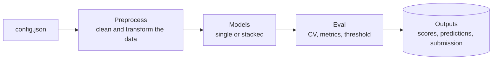
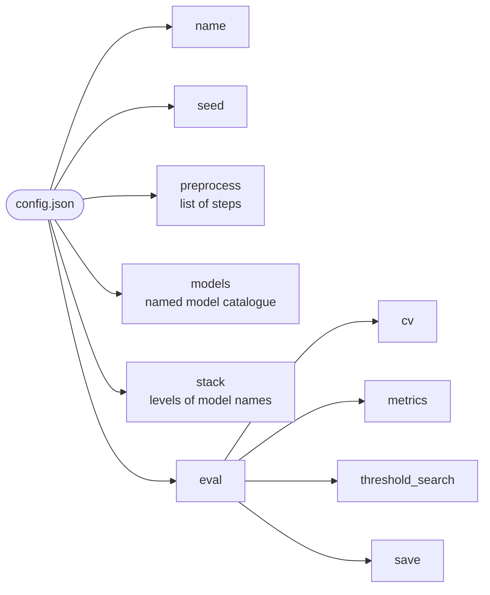
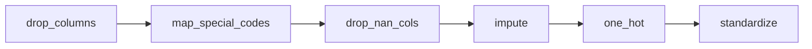
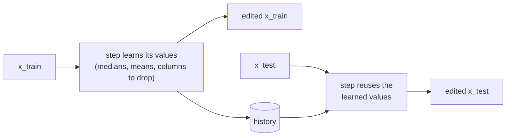
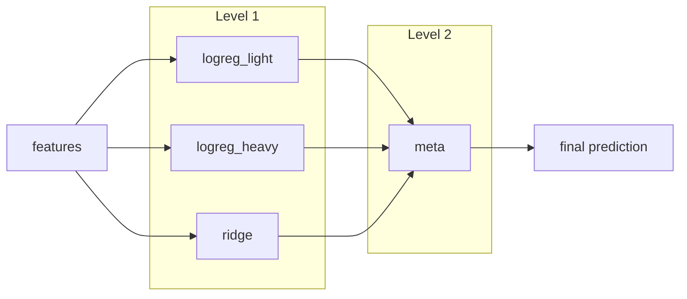
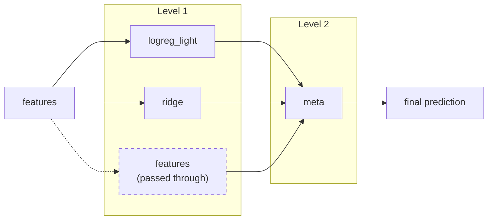
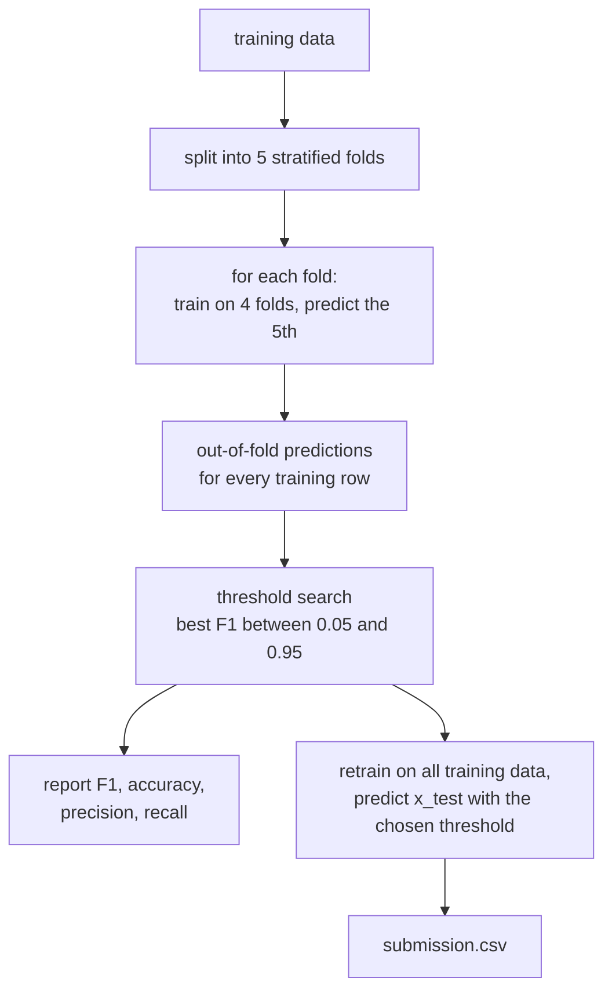
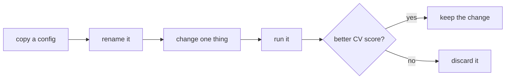

# Experiment configs

Every experiment in this project is described by **one JSON config file**. The pipeline reads the file and runs three stages in order:



Nothing about an experiment is hard-coded in Python. To try something new, you write a new config instead of editing code.

## Why configs?

- **Reproducible:** a result can always be traced back to the exact file that produced it.
- **Comparable:** two experiments differ only in what their configs say, so you can see exactly what changed.
- **Easy to split up:** teammates can run different configs in parallel without touching each other's code.
- **Easy ablations:** removing a line shows whether that step or model actually helps.

---

## File structure



| Key          | What it holds |
|--------------|---------------|
| `name`       | Unique name of the experiment; also used for the output folder |
| `seed`       | One random seed for everything (CV split, initialization, sampling) |
| `preprocess` | The ordered list of data-cleaning steps |
| `models`     | Every model used in this experiment, each with a short name and its settings |
| `stack`      | How the models are arranged: a list of levels, each a list of model names |
| `eval`       | How the result is validated and scored |

---

## `preprocess`

`preprocess` is a **list** of steps, and they run in exactly the order they are written:



Each step is an object with a `"step"` field naming the operation; every other key is a parameter for that step:

```json
{"step": "drop_nan_cols", "threshold": 0.8}
```

Each step edits `x_train` and `x_test` together. Any statistic it needs (medians, means, which columns to drop) is computed from **`x_train` only** and then applied unchanged to `x_test`. Every applied step is recorded in a history, together with what it learned, and the history is saved with the results.




---

## `models`

A catalogue of every model the experiment uses. Each entry has a short name of your choice; `name` inside it picks the implementation, and the remaining keys are its parameters:

```json
"models": {
  "logreg_light": {"name": "reg_logistic_regression", "lambda_": 0.001, "gamma": 0.1, "max_iters": 2000},
  "logreg_heavy": {"name": "reg_logistic_regression", "lambda_": 0.1,   "gamma": 0.1, "max_iters": 2000},
  "ridge":        {"name": "ridge_regression",        "lambda_": 0.01},
  "meta":         {"name": "logistic_regression",     "gamma": 0.1,     "max_iters": 500}
}
```

Pick names that say what is special about each model (`logreg_light` = light regularization). Defining a model here does nothing by itself; it only runs if `stack` uses it.

---

## `stack`

`stack` describes how the models are connected. It is a list of **levels**, and each level is a list of model names from the catalogue. Read it top to bottom like the layers of a network:

```json
"stack": [
  ["logreg_light", "logreg_heavy", "ridge"],
  ["meta"]
]
```



- The first level sees the preprocessed features.
- Every later level learns from the **predictions** of the level before it.
- The last level must contain **exactly one** model, which makes the final prediction.

### A single model

A single model is a stack with one level and one model:

```json
"stack": [
  ["logreg_light"]
]
```

### Passing the original features forward

The special name `"features"` (reserved, so don't use it in `models`) passes the original features on to the next level, alongside the predictions. This lets a later model correct mistakes the earlier ones make on specific kinds of people, instead of only averaging their opinions:

```json
"stack": [
  ["logreg_light", "ridge", "features"],
  ["meta"]
]
```



### How the levels are trained

- Each level trains on the **out-of-fold** predictions of the level before it: predictions on rows those models were not trained on. Otherwise the next level learns from overconfident predictions and trusts them too much.
- For `x_test`, each level's models are retrained on all training data, and the predictions flow through the levels in order.

### Rules of thumb

- Models within a level should be **different** from each other (model type, regularization, features). Near-identical models add nothing.
- Start with one level, then try two. Add a third only if it beats two on CV; every extra level adds a full round of k-fold training.
- If a stack does not beat the best single model, submit the single model.

---

## `eval`

```json
"eval": {
  "cv": {"folds": 5, "stratified": true, "shuffle": true},
  "metrics": ["f1", "accuracy", "precision", "recall"],
  "threshold_search": {"optimize": "f1", "min": 0.05, "max": 0.95, "step": 0.01},
  "save": ["oof_predictions", "history", "submission"]
}
```

| Key                | Meaning |
|--------------------|---------|
| `cv`               | Number of folds. `stratified` keeps the same share of positives in every fold, which matters because positives are rare. |
| `metrics`          | Everything reported for the run. F1 is the score that counts; precision and recall explain why it changed. |
| `threshold_search` | Tries decision thresholds between `min` and `max` on the out-of-fold predictions and keeps the best one for the test set. Use `null` to keep the default of 0.5. |
| `save`             | What the run writes to disk. |

How the pieces fit together:



---

## Creating a new experiment



1. Copy an existing config.
2. Give it a new `name` that says what is different, e.g. `logreg_nan06` or `stack_3models`.
3. Change **one thing** at a time, so you know what caused any change in the score:
   - a preprocessing step or one of its parameters,
   - a model's settings in `models`,
   - or the arrangement in `stack` (to try a new model, add it to `models` first, then list it in `stack`).

## Rules of thumb

- Steps that use the **labels** (selecting features by correlation with the target, over- or undersampling) must run **inside each CV fold**, never on the full training set.
- Steps that remove **rows** are only ever applied to training data, never to `x_test`.

---

## Full example

```json
{
  "name": "stack_baseline",
  "seed": 42,

  "preprocess": [
    {"step": "drop_columns", "columns": ["IDATE", "IMONTH", "IDAY", "IYEAR", "FMONTH",
                                         "SEQNO", "_PSU", "DISPCODE", "_STSTR", "_STRWT",
                                         "_RAWRAKE", "_WT2RAKE", "_LLCPWT"]},
    {"step": "fill_missing_values", "numeric": "median", "categorical": "mode"},
    {"step": "one_hot", "max_categories": 10},
    {"step": "standardize"}
  ],

  "models": {
    "logreg_light": {"name": "reg_logistic_regression", "lambda_": 0.001, "gamma": 0.1, "max_iters": 2000},
    "logreg_heavy": {"name": "reg_logistic_regression", "lambda_": 0.1,   "gamma": 0.1, "max_iters": 2000},
    "ridge":        {"name": "ridge_regression",        "lambda_": 0.01},
    "meta":         {"name": "logistic_regression",     "gamma": 0.1,     "max_iters": 500}
  },

  "stack": [
    ["logreg_light", "logreg_heavy", "ridge"],
    ["meta"]
  ],

  "eval": {
    "cv": {"folds": 5, "stratified": true, "shuffle": true},
    "metrics": ["f1", "accuracy", "precision", "recall"],
    "threshold_search": {"optimize": "f1", "min": 0.05, "max": 0.95, "step": 0.01},
    "save": ["oof_predictions", "history", "submission"]
  }
}
```