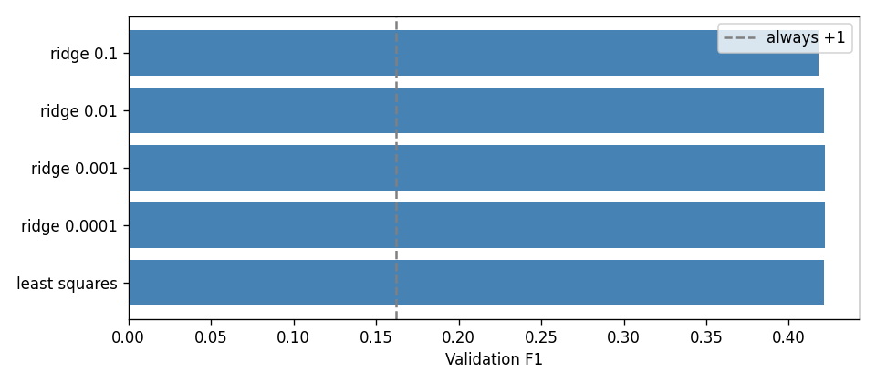
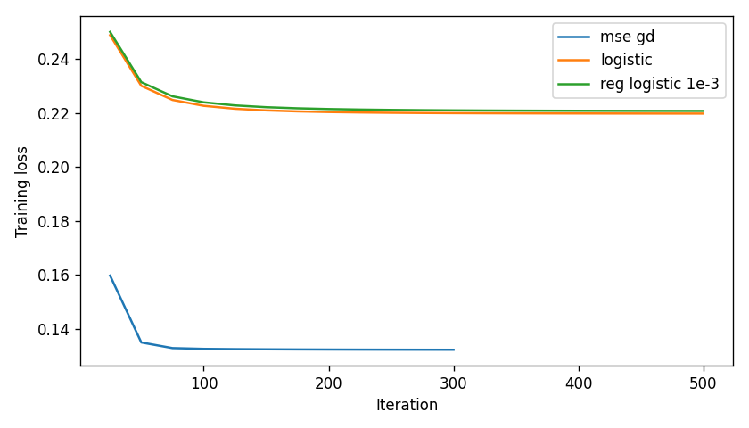

# Results

Stratified 5-fold means from `02_models_and_ablations.ipynb`. F1 uses a cutoff chosen on that fold's validation scores. AUROC does not.

Training labels: 28,975 positive of 328,135 (8.83%). Always -1: F1 0.000, accuracy 0.912. Always +1: F1 0.162, accuracy 0.088.

## Models

| model | F1 | std | precision | recall | accuracy | AUROC |
| --- | ---: | ---: | ---: | ---: | ---: | ---: |
| least squares | 0.410 | 0.003 | 0.326 | 0.551 | 0.860 | 0.845 |
| ridge 0.0001 | 0.408 | 0.003 | 0.334 | 0.531 | 0.864 | 0.844 |
| ridge 0.001 | 0.408 | 0.002 | 0.333 | 0.530 | 0.864 | 0.844 |
| ridge 0.01 | 0.407 | 0.003 | 0.327 | 0.538 | 0.861 | 0.844 |
| ridge 0.1 | 0.403 | 0.002 | 0.325 | 0.534 | 0.861 | 0.843 |
| mse gd | 0.407 | 0.003 | 0.338 | 0.511 | 0.868 | 0.843 |
| logistic | 0.410 | 0.003 | 0.330 | 0.541 | 0.862 | 0.848 |
| reg logistic 0.0001 | 0.410 | 0.003 | 0.330 | 0.542 | 0.862 | 0.848 |
| reg logistic 0.001 | 0.410 | 0.004 | 0.335 | 0.530 | 0.865 | 0.848 |
| reg logistic 0.01 | 0.409 | 0.003 | 0.332 | 0.533 | 0.864 | 0.847 |
| sgd | nan | nan | nan | nan | nan | nan |

## Ablations

Reference: ridge 0.0001. `delta` is the mean of the fold-by-fold F1 differences.

| change | delta | std | F1 | against |
| --- | ---: | ---: | ---: | --- |
| default cutoff | -0.401 | 0.004 | 0.007 | ridge 0.0001 |
| undersample 1:1 | +0.001 | 0.004 | 0.410 | ridge 0.0001 |
| undersample 1:3 | +0.003 | 0.003 | 0.411 | ridge 0.0001 |
| unpenalized intercept | +0.000 | 0.000 | 0.408 | ridge 0.0001 |
| class weight | +0.001 | 0.003 | 0.411 | unweighted logistic |
| clinical products | +0.002 | 0.003 | 0.410 | ridge 0.0001 |

## Figures

Least squares and ridge. The dashed line is always predicting +1.

Training loss on the first fold.

## Predictions

Refit `logistic` on all training rows. Validation F1 0.410 +/- 0.003. Cutoff 0.216. Predicted +1 on 15,775 of 109,379 test rows (14.42%).

The submission file is [predictions.csv](predictions.csv), with columns `Id` and `Prediction`.
